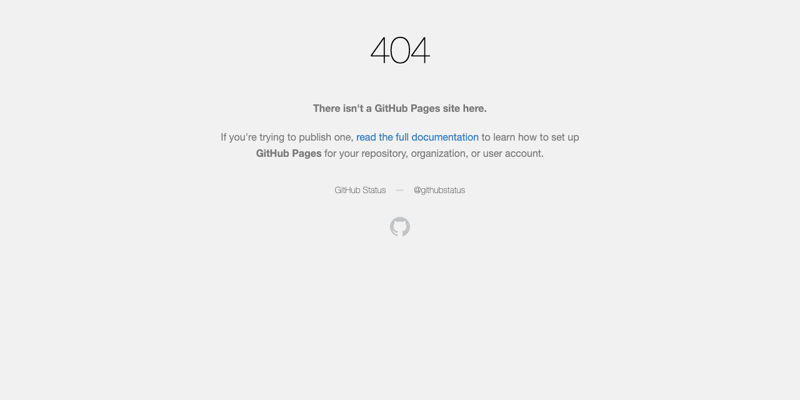

<div align="center">

# rustemmustafingovua-byte

**Tools that make AI agents actually usable — and charge for them in USDC.**

Now also building **Lumen**: a proof-of-stake chain that ships with its own market.

<p><a href="https://rustemmustafingovua-byte.github.io/rustemmustafingovua-byte/"></a></p>

Free-tier routing · MCP infrastructure · crypto micropayments · cost control · Lumen chain

</div>

---

**Public, keyless MCP endpoint** (also in the official MCP Registry as `io.github.rustemmustafingovua-byte/free-web-mcp`):

```jsonc
{ "mcp": { "free-web": { "type": "remote", "url": "https://64c61ba1c4530e.lhr.life/mcp", "enabled": true } } }
```

## Install the whole set (one command)

```bash
curl -fsSL https://raw.githubusercontent.com/rustemmustafingovua-byte/opencode-free-stack/main/install.sh | bash
```

No npm login, no token, no API keys — every CLI installs from its release tarball.

## Measured, not claimed

Every tool is benchmarked on this machine — medians of 3–5 runs, nothing invented:
**[benchmarks](https://github.com/rustemmustafingovua-byte/opencode-free-stack/blob/main/BENCHMARKS.md)**

## How this makes money

Paid API calls (USDC on Base), the Lumen chain's own market, npm distribution, sponsors
and bounties — all of it lands in one wallet: `0x8aC6a229f254980CCd3Dd35CF5E1B7c08880B40E`.

**[how it works](https://rustemmustafingovua-byte.github.io/rustemmustafingovua-byte/money.html)**

## Live status

Every project, version, CI state and running service in one page:
**[status](https://rustemmustafingovua-byte.github.io/rustemmustafingovua-byte/status.html)** · [raw](docs/status.html)

## What I build

Everything here is **MIT, tested, and solves a problem that breaks agent setups today**.

### A chain that doesn't need exchanges

| **[lumen-chain](https://github.com/rustemmustafingovua-byte/lumen-chain)** | a PoS chain with its own market — stake it, swap anything into it, never touch an exchange. P2P gossip, native AMM with LP shares, keeper that buys LMN via Uniswap V3 on Base | LP fees, donations (USDC on Base) |

### Agents and free AI

| Project | Problem it solves | Monetisation |
|---|---|---|
| **[opencode-free-stack](https://github.com/rustemmustafingovua-byte/opencode-free-stack)** | free model tiers fail in three specific ways (RPM, daily pools, model weight) — the router knows all of them and falls back automatically | hosted model registry, priced per call |
| **[free-tier-tracker](https://github.com/rustemmustafingovua-byte/free-tier-tracker)** | the model just answers `402` mid-run — a local ledger knows the quota is spent before it is | hosted quota service |
| **[prompt-budget](https://github.com/rustemmustafingovua-byte/prompt-budget)** | every request re-sends the whole context — measure it before you ship it | hosted budget API |
| **[agent-cost-guard](https://github.com/rustemmustafingovua-byte/agent-cost-guard)** | agent loops are unbounded — a proxy enforces tokens, spend and rounds | hosted guard proxy |

### MCP infrastructure

| Project | Problem it solves | Monetisation |
|---|---|---|
| **[agent-browser-mcp](https://github.com/rustemmustafingovua-byte/agent-browser-mcp)** | an agent that can only call APIs cannot read the pages that matter — this gives it a real browser, with challenge handling under a budget | hosted MCP, free tier |
| **[mcp-doctor](https://github.com/rustemmustafingovua-byte/mcp-doctor)** | MCP servers break silently — this says exactly which one and why | hosted diagnostics |
| **[mcp-proxy](https://github.com/rustemmustafingovua-byte/mcp-proxy)** | one endpoint in front of many servers, with keys, limits, logs and replay | hosted relay |
| **[tool-schema-lint](https://github.com/rustemmustafingovua-byte/tool-schema-lint)** | agents call tools wrongly because the schema is ambiguous | hosted lint API |
| **[free-web-mcp](https://github.com/rustemmustafingovua-byte/free-web-mcp)** | web search for agents costs credits per call | hosted MCP, $0.001 / call — also live in the official MCP Registry as a public endpoint |

### Crypto and safety

| Project | Problem it solves | Monetisation |
|---|---|---|
| **[agent-x402](https://github.com/rustemmustafingovua-byte/agent-x402)** | an agent that can pay can be drained by one prompt injection | hosted relay, policy service |
| **[x402-priceboard](https://github.com/rustemmustafingovua-byte/x402-priceboard)** | what does an x402 endpoint actually cost? | hosted price API |
| **[prompt-injection-guard](https://github.com/rustemmustafingovua-byte/prompt-injection-guard)** | the files an agent reads by itself may contain hidden instructions | hosted scanner |

### Quality

| Project | Problem it solves |
|---|---|
| **[opencode-doctor](https://github.com/rustemmustafingovua-byte/opencode-doctor)** | audit an OpenCode install in one command |
| **[readme-doctor](https://github.com/rustemmustafingovua-byte/readme-doctor)** | why nobody is using your repository — checked in one command |

## Why crypto

The buyer of an agent tool is an agent — and agents pay with x402: USDC on Base,
per call, no account, no card, no KYC. That fits a market where subscriptions do
not work.

## Principles

- **Free first.** Every project has a genuinely free path; paid tiers add limits, not features.
- **Honest limits.** Free tiers fail in documented ways. Name them instead of pretending they do not exist.
- **Policy outside the model.** Anything an agent can trigger is capped in code.
- **MIT, forever.** The business model is hosting, not the licence.

## Support

Donations in USDC on Base:

```
0x8aC6a229f254980CCd3Dd35CF5E1B7c08880B40E
```

## Stack

TypeScript · Node · MCP · OpenAI-compatible APIs · viem · x402 · USDC · Base · Solana · GitHub Actions
